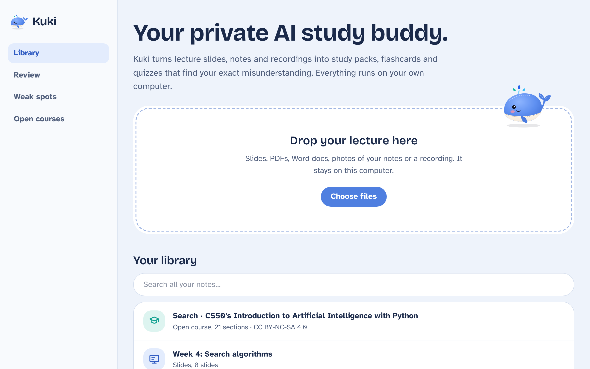
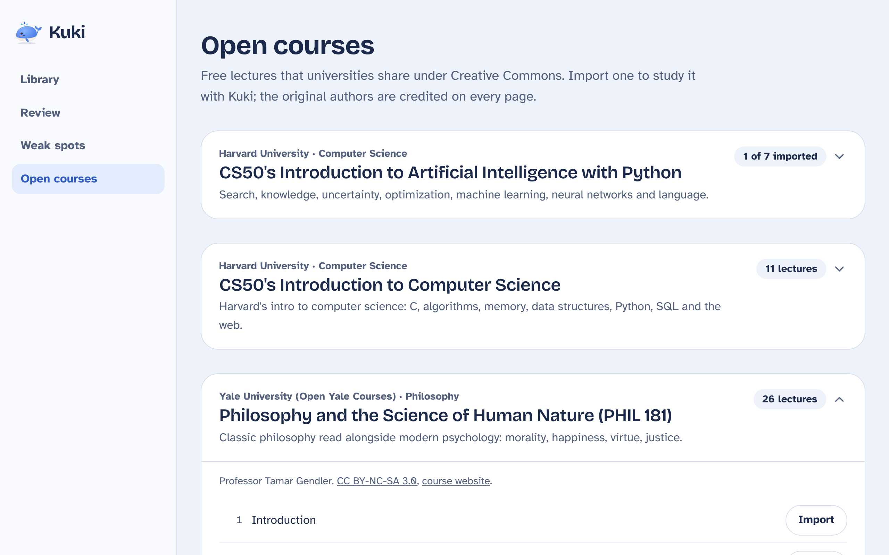

<p align="center"></p>

<h1 align="center">Kuki</h1>

<p align="center"><b>Your private AI study buddy.</b><br>
Kuki turns lecture slides, notes and recordings into cited study packs, flashcards and quizzes that find your
exact misunderstanding. It runs 100% offline on your own computer with Ollama.</p>



## Why

Students drown in lecture material: 60-slide decks, blurry whiteboard photos, hour-long recordings. AI tools can
help, but most need a constant connection, charge per use, and send coursework to someone else's servers. That
shuts out the students who would benefit most: those with expensive data, unreliable internet, or institutions
that forbid uploading course material.

Kuki keeps everything on the student's laptop. No account, no API bill, no data leaving the device.

## What it does

| | |
|---|---|
| **Reads anything** | PDF, PowerPoint (including speaker notes), Word, Markdown/text, photos of notes (local OCR), and lecture recordings (local Whisper). Every passage keeps its location: *Slide 4*, *Page 12*, *16:29*. |
| **Cited study packs** | Key concepts, main points, examples and common mistakes. Every line links to the slide, page or timestamp it came from; tap it to read the original. |
| **Misconception quizzes** | Open questions answered in your own words. Kuki says what you got right, names the *specific* wrong or missing idea, and asks one guiding question so you fix it yourself. |
| **Weak spots** | Every attempt feeds a map of concepts you've mastered, are improving on, or keep missing, plus your most common *kind* of mistake. |
| **Spaced-repetition flashcards** | Generated from your material, scheduled with SM-2, reviewable with the keyboard, exportable to Anki. |
| **Ask** | Questions answered only from your notes, with citations. "That's not in your notes" is a valid answer. |
| **Open Course Library** | One-click import of openly licensed lectures from **Harvard CS50** and **Open Yale Courses**, with transcripts split by timestamped chapter and recordings you can save for offline listening. |



## Quick start

You need **Python 3.11+**, **Node.js 20+** (to build the web app once) and **[Ollama](https://ollama.com)**.

```bash
ollama pull llama3.2:3b          # the study model (~2 GB)
ollama pull nomic-embed-text     # optional: better search
```

```bash
./run.sh            # macOS / Linux
```

```powershell
.\run.ps1           # Windows
```

Open <http://127.0.0.1:8765>. Add `--full` (`-Full` on Windows) to also install photo OCR and recording
transcription. Try it with the original demo deck in [`samples/search-algorithms.pptx`](samples/search-algorithms.pptx).

### Development

```bash
cd backend && python -m venv .venv && .venv/bin/pip install -r requirements-dev.txt
.venv/bin/python -m kuki --reload           # API on :8765
cd frontend && npm install && npm run dev   # UI on :5173, proxies /api
```

No model on your machine? `python backend/scripts/mock_ollama.py` stands in for Ollama during UI work. It is a
**development-only** fake: its answers are sliced from your notes, not generated by a model.

## How it works

```
 files ─► readers (pdf/pptx/docx/ocr/whisper) ─► located segments ─► SQLite
                                                       │
                              BM25 + embeddings ◄──────┘  (reciprocal rank fusion)
                                                       │
            numbered sources [S1] [S2] … ─► Ollama (JSON-schema constrained output)
                                                       │
            citations resolved back to real segments; invented tags dropped ─► UI
```

More detail in [docs/ARCHITECTURE.md](docs/ARCHITECTURE.md).

## Responsible AI

* **Private by design.** Material, embeddings and generated content stay in `~/.kuki`. The server binds to
  localhost and rejects non-localhost Host headers (DNS-rebinding defence). The only network access is the
  Open Course importer, run when you click Import, and it can be disabled with `KUKI_ALLOW_DOWNLOADS=0`.
* **Checkable, not trusted.** Every generated claim carries citations to real passages. Citations the model
  invents are dropped; in the default *Only my notes* mode, uncited claims are removed entirely.
* **Honest about gaps.** *Fill gaps* mode lets Kuki add missing steps, but each one is labelled
  *Not from your notes*.
* **Coaching, not answers.** Quiz feedback hides the model answer until asked and leads with a guiding question.
* **Graceful without AI.** If Ollama is off, packs are copied from your notes (still cited), quizzes use recall,
  grading matches key ideas and says what it can't do, and search falls back to keywords.

See [docs/RESPONSIBLE_AI.md](docs/RESPONSIBLE_AI.md) for limitations.

## Credits and licenses

Kuki's code is MIT licensed. Imported lectures keep their own licenses, shown on every imported document:
Harvard CS50 materials are [CC BY-NC-SA 4.0](https://cs50.harvard.edu/x/license/); Open Yale Courses are
[CC BY-NC-SA 3.0](https://oyc.yale.edu/terms). Kuki fetches them on the user's request for personal study and
does not redistribute them. See [NOTICE.md](NOTICE.md).

Built for **SLAY HACKS 2026**. Kuki 2.0 was rebuilt from scratch during the hackathon (Nov 2026) on the
`kuki-2.0` branch; an earlier Streamlit prototype lives in this repository's history.
